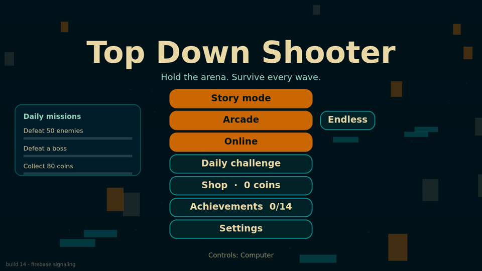
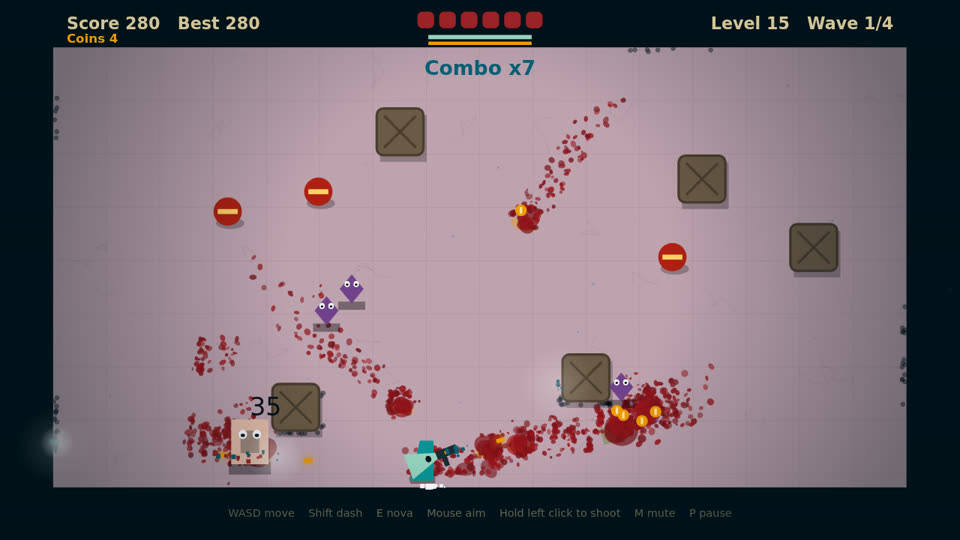
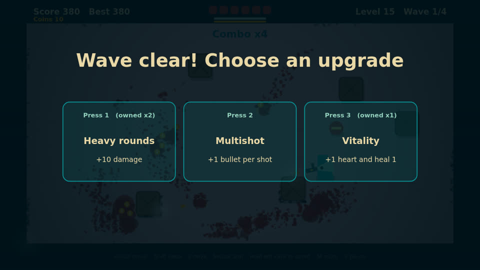

# Top Down Shooter (Shooter-2D)

A canvas top-down arena shooter ported to a single self-contained `index.html` from the Godot "Top Down Template 2D" project. No build step, no external runtime dependencies: open the page and play.

**Live demo:** https://faresdief.github.io/Shooter-2D/

<p>
  
  
  
</p>

## Features
- Story mode, Arcade, Endless and Daily challenge modes
- Waves, weapons and upgrades, bosses, coins and a shop
- Achievements, daily missions, persistent saves (localStorage, import/export)
- Touch, keyboard/mouse and gamepad controls
- Online top-10 leaderboard (Scores button on the menu, post from the game-over screen)
- Optional peer-to-peer online rooms (WebRTC with Firebase signaling; manual codes as fallback)
- PWA manifest + service worker for offline play

## Running locally
Any static file server works:

```bash
python3 -m http.server 8000
# open http://localhost:8000/
```

Opening `index.html` directly also works, but the service worker (offline support) needs HTTP(S).

## Tests
Dependency-free, run with plain Node (no install):

```bash
node test/smoke.mjs      # boots the game in a stubbed DOM, checks the render loop and the boot watchdog
node test/gameplay.mjs   # runs real game functions: weapons, wave sizes, bosses, difficulty, scoring, damage
```

The gameplay test reaches the game's internals through a hook that only exists when `window.__TDS_TEST__` is set, so it does nothing in the browser.

## Resilience
A boot watchdog in `index.html` shows a visible error card with a reload button instead of a silent blank canvas if startup fails or the first frame never renders.

## Credits
Gameplay structure ported from the Godot "Top Down Template 2D". Colours are the original palette; all code here is plain HTML/Canvas/JS.

## Online security (Firebase rules)
Online rooms use a Firebase Realtime Database only to pass short signaling messages between players. The rules in `database.rules.json` lock it down:
- Nothing is readable or writable by default. Only `tds/tdsq-<code>` room channels are open, and the list of all rooms cannot be read.
- Every message must be an object with a single `m` string of at most 30000 characters. Messages can be created or deleted but never overwritten.
- The shared lobby channel (`tdsq-lobby1`) cannot be deleted as a whole.
- There is no sign-in, so anyone who knows a room code can still read that room's messages. Room passwords are checked by the host, not by the database.

To publish: Firebase console > Realtime Database > Rules, paste the file, Publish.
- `tds-scores` holds the leaderboard: anyone can read it, entries can only be created (never changed or deleted), and each one must be a name up to 14 characters, a whole-number score from 1 to 10,000,000 and a server timestamp. The game runs in the browser, so a determined player can still post a made-up score within that range.
